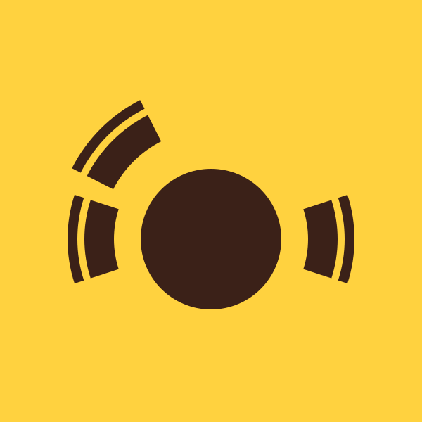

# SideTable brand guide for AI agents

Version: 2.0 · Approved palette: golden yellow + espresso brown · Updated: 2026-10-25

## Scope and source of truth

Use this document when producing SideTable brand assets, interfaces, websites, app icons, social images, or marketing materials. SideTable is a desktop client for apron.chat. Do not imply that SideTable is an official Apron product unless separately confirmed.

This guide translates the approved version 2.0 PDF into implementation instructions. It supersedes earlier monochrome-only palette guidance. The approved symbol geometry is unchanged. This version 2.0 kit supplies the updated color exports. The original version 1.0 kit remains monochrome.

The supplied SVG paths are authoritative. Reuse them rather than regenerating, tracing, or approximating the logo. The primary symbol SVG is embedded below so this document remains useful even when its companion files are missing.

## Brand intent

A small table, three chairs, and an invitation to conversation. The identity draws on a neighborhood bistro: warm, welcoming, clear, and informal. Golden yellow supplies energy; espresso brown grounds it. Express the bistro idea through the approved symbol and palette, not added decorative props.

## Color tokens

| Token | HEX | RGB | Role |
| --- | --- | --- | --- |
| Golden yellow | `#FFD23F` | `255, 210, 63` | Signature background, app tile, social avatar, brand highlights |
| Espresso brown | `#3B2118` | `59, 33, 24` | Primary symbol, wordmark, text, dark surfaces |
| White | `#FFFFFF` | `255, 255, 255` | Supporting neutral and reading surfaces |

```css
:root {
  --sidetable-yellow: #FFD23F;
  --sidetable-espresso: #3B2118;
  --sidetable-white: #FFFFFF;
  --sidetable-brand-background: var(--sidetable-yellow);
  --sidetable-brand-foreground: var(--sidetable-espresso);
}
```

Treat the HEX values as exact digital values. Do not replace espresso with pure black in the primary color treatment. For print, convert through the printer's color profile and approve a proof; there is no approved universal CMYK or Pantone equivalent.

## Allowed combinations

| Context | Background | Symbol / wordmark / text |
| --- | --- | --- |
| Primary brand treatment | Golden yellow | Espresso brown |
| Dark brand treatment | Espresso brown | Golden yellow |
| Neutral reading surface | White | Espresso brown |
| Optional neutral reverse | Espresso brown | White |
| One-color fallback | White or black | Black or white, respectively |

Keep the symbol and wordmark single-color within each placement. Do not assign different colors to the individual chairs. Espresso against golden yellow has a calculated sRGB contrast ratio of approximately **10.27:1**. Do not use white on yellow or yellow on white for the logo or reading text. Functional status colors remain separate from brand colors; branding does not replace error, success, or focus-state design.

## Symbol geometry: preserve exactly

The symbol is an overhead circular table with three seats and three separate curved backrests. Two chairs sit on the left side; one sits on the right. Preserve the asymmetry.

The upper-left chair's slight outward offset is intentional in the approved production artwork. **Do not normalize all backrests onto the same radius.** Earlier exploration requested that construction, but the subsequently approved artwork retained the offset.

- SVG viewBox: `0 0 600 600`.
- Table center: `(300, 340)`; table radius: `100`.
- Chair center angles: `180°`, `225°`, and `0°`.
- Coordinates use SVG's y-down convention: 0° points right; 225° points upper-left.
- Each chair spans `36°` (center angle ±18°).
- Left and right seat inner/outer radii: `138 / 180`.
- Left and right backrest inner/outer radii: `190 / 204`.
- Upper-left chair: add `18` to both radii of the seat and backrest, giving `156 / 198` and `208 / 222`.
- All arcs share the table center, but the upper-left arcs use different radii.
- End cuts are straight radial edges, not rounded caps.
- The table circle's position within the canvas is deliberate; do not recenter it independently of the rest of the artwork.

The embedded SVG is the final authority if a reconstruction differs from these descriptions. There are no flowers, vases, checks, grain textures, gradients, or shadows.

## Clear space and minimum sizes

Leave at least half the table radius clear around the visible artwork: `50` source units for a symbol with radius `100`. Measure from the artwork's visible bounds, not the edge of its canvas. Scale clear space proportionally. Preserve aspect ratio and internal spacing.

Suggested minimum overall export widths:

- Standard symbol: `32 px`.
- Stacked symbol + wordmark: `160 px`.
- Horizontal symbol + wordmark: `240 px`.
- At `16–24 px`, use the reinforced micro symbol supplied in web/ and source/ in this kit, rather than shrinking a full wordmark.

The micro geometry retains the same table and seats but uses backrest inner/outer radii `194 / 214`, plus the same `18` upper-left offset. This widens the seat-to-back gap and thickens the backrest. Inspect raster exports at their actual size; these minimums are design guidance, not a guarantee of legibility on every display.

## Typography and naming

- Product spelling: **SideTable**, with capital S and T. Do not write “Sidetable” or “Side Table” as the product name.
- Approved production wordmark: **Poppins SemiBold**, converted to paths in the supplied assets.
- Supporting copy: **Poppins Regular**, or the platform system sans-serif.
- Prefer supplied outlined wordmarks. Do not substitute a live-text approximation when a logo asset is available.
- The original generated concept had no identifiable font source. Poppins SemiBold is the standardized production wordmark, not a claim about that generated image's font.
- Fonts are not bundled. Outlined logo assets do not require font installation. If using Poppins for live UI copy, obtain the font through the project's normal licensed font workflow.

## Application rules

### App icons and avatars

Default to the espresso symbol on a golden-yellow field. Use yellow on espresso as the dark alternative. Keep generous padding for platform masks and circular avatar crops.

The embedded source is a full square with no baked corner mask. Let the destination platform or export specification determine corner treatment. A rounded-square presentation mockup is not a required mask for every asset. Do not flatten the icon onto a white field when the intended background is yellow.

### Websites and interfaces

Use espresso or white for large reading areas and yellow for memorable brand areas. Yellow buttons use espresso text. Use the horizontal logo for compact headers, the stacked logo for covers and introductions, and the symbol alone where the product is already identified.

### Social images

Useful export targets from the existing workflow: `1080 × 1080 px` avatars/posts and `1200 × 630 px` link-preview images. Keep the symbol within a safe central area for cropping. These are practical export targets, not a promise about every platform's current requirements.

### Export behavior

Use SVG or vector PDF for scalable artwork. Export PNG at the destination's requested size. Transparent symbol/wordmark assets and opaque icon tiles are different deliverables: retain the yellow background for the primary app tile, but remove only the background rectangle when a transparent symbol is requested.

Do not overwrite earlier approved variants unless explicitly asked. When placing deliverables in Finder-visible locations on macOS, verify that neither the files nor their enclosing delivery folder has the `hidden` flag set.

## Primary graphic and companion assets



Companion files, when supplied alongside this document:

- `SideTable-Yellow-Espresso.svg`: primary full-square symbol on yellow.
- `SideTable-logo-stacked-Espresso.svg`: transparent stacked logo with outlined lettering.
- `SideTable-logo-horizontal-Espresso.svg`: transparent horizontal logo with outlined lettering.
- `SideTable-wordmark-Espresso.svg`: transparent outlined wordmark.

Some Markdown viewers do not display local SVG images. The SVG source below is embedded directly and is sufficient to recreate the primary icon without any companion file. Save the contents of the code block as an `.svg` file. Do not include the Markdown fences.

```svg
<svg xmlns="http://www.w3.org/2000/svg" width="600" height="600" viewBox="0 0 600 600" role="img" aria-label="SideTable">
  <title>SideTable</title>
  <rect width="600" height="600" fill="#FFD23F"/>
  <g fill="#3B2118">
    <circle cx="300" cy="340" r="100"/>
    <path d="M 128.80983,395.62306 A 180 180 0 0 1 128.80983,284.37694 L 168.75420,297.35565 A 138 138 0 0 0 168.75420,382.64435 Z"/>
    <path d="M 105.98447,403.03947 A 204 204 0 0 1 105.98447,276.96053 L 119.29926,281.28677 A 190 190 0 0 0 119.29926,398.71323 Z"/>
    <path d="M 123.58071,250.10988 A 198 198 0 0 1 210.10988,163.58071 L 229.17748,201.00298 A 156 156 0 0 0 161.00298,269.17748 Z"/>
    <path d="M 102.19655,239.21411 A 222 222 0 0 1 199.21411,142.19655 L 205.56998,154.67064 A 208 208 0 0 0 114.67064,245.56998 Z"/>
    <path d="M 471.19017,284.37694 A 180 180 0 0 1 471.19017,395.62306 L 431.24580,382.64435 A 138 138 0 0 0 431.24580,297.35565 Z"/>
    <path d="M 494.01553,276.96053 A 204 204 0 0 1 494.01553,403.03947 L 480.70074,398.71323 A 190 190 0 0 0 480.70074,281.28677 Z"/>
  </g>
</svg>
```

### Safe SVG variants

Make only the following paint changes; preserve all path coordinates, transforms, and viewBox dimensions:

- **Dark reverse:** background rectangle `#3B2118`; foreground group `#FFD23F`.
- **Transparent espresso symbol:** remove the background rectangle; retain foreground `#3B2118`.
- **Transparent yellow symbol:** remove the background rectangle; foreground `#FFD23F`; place only on espresso or a verified contrasting surface.
- **Monochrome fallback:** use a single black or white foreground against a contrasting field.

The outer rectangle is a background, not part of the symbol geometry. Do not remove the table circle or any of the six chair paths. For logos with lettering, use the companion outlined SVGs rather than adding text to this symbol.

## Agent acceptance checklist

Before handing off a SideTable artifact:

- [ ] The primary palette uses exact `#FFD23F` and `#3B2118` values.
- [ ] The mark contains one circular table, three seats, and three backrests.
- [ ] Chair angles, depth, spacing, and the upper-left offset are preserved.
- [ ] The mark is not stretched, rotated, outlined, decorated, or given shadows.
- [ ] Logo and wordmark colors agree within the placement.
- [ ] Text uses the correct SideTable capitalization.
- [ ] Background treatment and transparency match the destination.
- [ ] Small raster assets have been inspected at actual size.
- [ ] White-on-yellow and yellow-on-white treatments are absent.
- [ ] Files use useful, descriptive names, and local delivery files are visible.

This checklist governs brand implementation only. It does not authorize publishing, deployment, account changes, or messaging other people.
