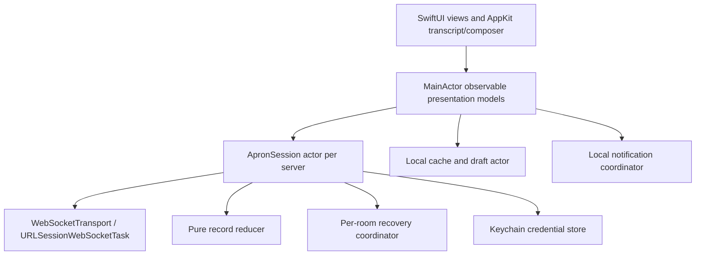

# Sidetable: Native macOS Client for Apron

Status: proposed design; no application code implemented.

## Product direction

Build **Sidetable**, a native Swift client for independent Apron servers. The working name comes from this repository. Prioritize readable conversations, dependable reconnects, and familiar Mac interaction. Use the web client as a behavioral reference and the protocol specification as the authority.

Proposed baseline: macOS 14+, Swift 6 language mode, SwiftUI with focused AppKit integration. Support both Apple silicon and Intel where the selected toolchain permits. Confirm the deployment target and toolchain during project setup.

Version one supports multiple saved servers, one account per server, and simultaneous connections. Each server owns its identity, rooms, capabilities, and state. No unified cross-server timeline. Apron is server-authoritative, without federation or end-to-end encryption; TLS protects transport. [Protocol overview](https://github.com/shazow/apron)

## Window and visual design

Use a standard macOS window with a unified toolbar, resizable sidebar, conversation area, and optional trailing inspector. Initial size: approximately 1,160 × 780 points; minimum: 760 × 540. At narrow widths, the inspector replaces part of the conversation rather than squeezing the composer below a usable width.

```text
┌────────────────────────────────────────────────────────────────────┐
│ ● ● ●   Sidebar     # general             Jump to…       Inspector │
├───────────────────┬─────────────────────────────┬──────────────────┤
│ Work ▾        ＋  │ General                     │ Thread           │
│ Connected         │ Project conversation        │ Release checklist│
│                   ├─────────────────────────────┤                  │
│ ROOMS             │ Ada                    10:42 │ Ben        10:44 │
│ # general     3   │ The new build is ready.     │ Looks good.      │
│   Release…    1   │ [Release checklist · 2]     │                  │
│ # development     │                             │                  │
│ 🔒 planning       │ ───── New messages ──────── │                  │
│                   │ Ben                    10:43 │                  │
│ Browse rooms…     │ Testing the reconnect now. │                  │
│                   ├─────────────────────────────┼──────────────────┤
│ Ada · Online      │ Message #general…           │ Reply…           │
└───────────────────┴─────────────────────────────┴──────────────────┘
```

The server picker shows connection state and unread totals for each saved server. The sidebar lists joined rooms, with threads nested beneath their parent. Public room discovery opens a sheet. Private rooms carry a lock and remain subject to server visibility rules; there is no invented direct-message API.

The inspector has mutually exclusive **Thread** and **Members** modes. Selecting a thread preserves its parent conversation and gives the thread its own composer and draft. At minimum width, a thread can occupy the main conversation, with a back control. Threads are rooms with `parent_room_id`; replies using `reply_to` are a separate interaction. [Web client behavior](https://github.com/apron-chat/apron-web/blob/dede439ebda1376234ced3fc0dbd2e76008bb480/docs/behavior.md)

Use system fonts, semantic foreground/background colors, SF Symbols, restrained separators, and the system accent. Messages form a continuous transcript rather than alternating bubbles. Group consecutive senders, show timestamps unobtrusively, and retain distinct date and unread dividers. Role badges stay separate from display names. Duplicate names show user IDs. Provide light/dark appearance, adjustable message size, VoiceOver labels, keyboard focus, reduced motion, and increased contrast.

## Main interactions

### Connect and sign in

The first window offers **Add Server** with a hostname or WebSocket URL. Normalize bare hosts to `wss://host/`; preserve explicit paths such as `/ws`. Do not silently append `/ws`. Show the server host, welcome text, and advertised sign-in methods after its `server` frame arrives.

Initially implement guest, token, and email-code authentication. Store returned tokens in Keychain and replace them on rotation. An expired token produces **Sign in again**, preserving drafts; do not silently switch a registered user to a guest. Unknown authentication schemes receive an explanatory unsupported state.

Email codes must be proposed and approved on the same unauthenticated connection. Use a separate pending connection when switching from an existing session; adopt it only after successful authentication. A reconnect invalidates a short-code attempt. Native passkeys are a separate compatibility milestone described below.

### Read, compose, and navigate

- Return sends; Shift-Return inserts a newline; Command-Return also sends. Return first accepts any active completion. Respect marked text during input-method composition.
- `@` completion inserts a user reference and populates `body.mentions`; visible text alone never determines notification eligibility.
- Command-K opens the room/thread switcher. Command-F searches loaded messages, labeled **Find in loaded messages**. There is no assumed server search endpoint.
- Command-comma opens Settings. Standard copy, paste, selection, context menus, and toolbar sidebar controls remain available.
- Keep drafts per server, account, room, and reply context. Save text locally; keep staged attachments session-only initially and explain that limitation when quitting with attachments.
- Reply, edit, delete, react, and create-thread actions appear where supported. Destructive actions require confirmation. Server errors explain rejected actions without discarding the draft.

Pending sends occupy a distinct presentation layer until a result identifies the server message. Never match an echo by text. An ambiguous timeout displays **Delivery uncertain**; offer deliberate retry using the original operation ID and payload. Server deduplication is recommended, not guaranteed indefinitely, so never promise exactly-once delivery. [Protocol §1.2](https://github.com/shazow/apron/blob/9e3094c0ca10ca23d228924c29537da959ace613/PROTOCOL.md#12-retries-and-deduplication)

Maintain the visible scroll anchor while older history loads. Auto-scroll only when already at the bottom or after an explicit local send. Otherwise show a new-message button. Loading, empty room, reconnecting, read-only, and authentication failure are distinct states.

### Attachments and notifications

Drag files into the composer or use a file picker. With `embed:upload`, first send pending embed descriptors, then PUT bytes to the returned `write_url`; a later authoritative snapshot marks completion. Show independent upload progress and failure. Treat write URLs as credentials and never log them. Render images and file cards natively, with explicit downloads and Quick Look for supported downloaded files.

Version one sends local notifications while the app is running and connected, including with all windows closed. Quit ends connectivity. Ask for notification permission when the user enables alerts. Default to mentions and replies, suppress own messages and visible attended conversations, and deduplicate by server/account/message. Historical replay and restored cache never produce notification floods. APNs or an Apron push relay requires a separate server integration; browser Web Push is not a native push implementation.

## Capability-driven scope

Every replacement `server` frame refreshes available actions without deleting displayed content. Roles are labels, not a local authorization system. [Protocol capabilities](https://github.com/shazow/apron/blob/9e3094c0ca10ca23d228924c29537da959ace613/PROTOCOL.md#4-capabilities)

| Server support | Client behavior | Without support |
| --- | --- | --- |
| Core messages/auth | Send and receive in the default room | Required for a usable connection |
| `rooms` | Discover, join, leave, create rooms and threads; inspect members | Single default conversation; omit `room_id` when sending |
| `history` | Recover missed changes and page older records | Show live messages and disclose the history gap |
| `edit` | Edit/delete and move messages | Hide mutation actions |
| `reactions` | Send the current user's complete emoji set | No reaction controls |
| `activity` | Typing indicators and read cursors | Local unread tracking only |
| `status` | Attendance, advertised status choices, server mutes | Local notification preferences only |
| `embed:upload` | File staging and uploads | Disable attachment sending |
| `command` | Forward server commands, including their transient replies | Do not reinterpret slash text as a command |
| `ext` / `ext:settings` | Preserve extension values; honor applicable settings | Do not send extension fields |

Defer streaming embed rendering, interactive HTML/iframe embeds, voice/video, server-wide search, native remote push, and multiple accounts on the same server. Unknown embeds render a safe descriptive fallback. No embedded browser is required for the initial chat interface.

## Swift architecture



Use SwiftUI for window composition, navigation, settings, sheets, and rows. Use `NSTextView` for the composer and selectable transcript text. Start the transcript with an `NSCollectionView` wrapper so reuse, variable-height layout, and scroll anchoring are explicit. Prototype selection and accessibility before committing to custom layout complexity.

`ApronSession` owns ordered frame handling, request continuations, transport lifetime, timeouts, and connection generations. One receive loop processes frames serially; never launch independent reducer tasks for individual frames. Publish immutable, coalesced presentation changes on the main actor. A socket generation prevents obsolete responses from mutating a newer session.

Use Foundation's [URLSessionWebSocketTask](https://developer.apple.com/documentation/foundation/urlsessionwebsockettask) behind an injectable transport interface. Protocol ping/pong frames are application messages, distinct from WebSocket control-frame pings.

Suggested layout:

```text
Sidetable.xcodeproj             macOS application and UI test targets
Sidetable/App/                  scenes, menus, lifecycle, dependency wiring
Sidetable/Features/             connection, sidebar, transcript, composer, settings
Sidetable/Platform/             Keychain, notifications, AppKit adapters
Sidetable/Resources/            asset catalog and localized strings
Packages/ApronCore/Sources/     wire types, reducer, session, recovery
Packages/ApronCore/Tests/       fixtures and deterministic transport tests
SidetableTests/                 persistence and presentation tests
SidetableUITests/               user journeys and accessibility checks
plans/                         design decisions and implementation plans
```

Keep ApronCore free of SwiftUI and AppKit. Use `Codable` models with an explicit JSON-value type for extensions and unknown embed data. Model field presence separately from null and empty values where merging requires it. Parse log/message IDs as validated positive `UInt64` values below `2^53`, encode them as decimal strings, and keep opaque IDs as strings.

## State and recovery invariants

Follow the pinned specification, particularly §§2 and 4.2, and translate upstream fixture expectations before optimizing. [Protocol](https://github.com/shazow/apron/blob/9e3094c0ca10ca23d228924c29537da959ace613/PROTOCOL.md)

1. Key messages by message ID, rooms by room ID, reactions by message/user, and memberships by room/user, all scoped to a server/account. The greatest `log_id` wins. A moved message changes room without acquiring a new identity; tombstones must prevent stale resurrection.
2. Current user objects and recorded sender snapshots have different merge semantics. Complete current objects replace, patches merge, and historical sender objects never overwrite current identity. Preserve explicit clears and the user's own status separately from others' view of it.
3. Recover each displayed room independently: buffer live records, capture head H, page forward from checkpoint C + 1 or the history lower bound through H, then apply buffered records above H. Advance a checkpoint only after the covered interval is complete.
4. Bounds are inclusive. Continue using `last_log_id + 1` or `first_log_id - 1`, never the IDs remaining after compaction. IDs are sparse. Inspect retention bounds on every page; if retention overtakes uncovered history, clear and rebuild that room. Null `history_log_id` means an effective bound of `latest_log_id + 1`.
5. Load threads independently when opened. Keep historical pagination separate from live recovery. Bound live buffering; if exceeded, restart recovery instead of silently dropping records.
6. Honor retry delays and use jittered exponential reconnect backoff. Stop automatic retries for connection-level denial. On wake, verify transport health, authenticate, and recover before enabling writes.
7. Request IDs are random strings. Serialize operations that depend on earlier results. Ordinary mutation broadcasts precede their results; sign-in notifications follow successful auth. Apply incoming frames in received order.

## Local storage and trust boundaries

Persist server definitions, UI preferences, and text drafts in Application Support using versioned Codable files and atomic replacement. A bounded per-account snapshot cache can accelerate launch; it is display-only, clearly marked as checking for updates. Initially, rebuild live protocol state after relaunch rather than treating a truncated cache as a complete replay checkpoint. Same-process reconnects retain full recovery state. Move to SQLite only if measured cache/query needs justify it.

Keychain entries include the full normalized endpoint and account identity. Preserve path/query distinctions; redact credential-bearing URLs in diagnostics. Purge credentials, snapshots, and drafts for an account on explicit sign-out. Never render one account's cache after authenticating as another.

Require TLS by default; allow explicit local-development connections without disabling certificate validation globally. Media loads use the server origin or explicitly trusted media origins, including redirect checks. Do not attach the session token to arbitrary media requests. Render Markdown with a bounded, tested CommonMark parser and native views; do not execute raw HTML. Add sandbox outgoing-network and user-selected-file entitlements during app setup.

## Compatibility gates and open decisions

- **Passkeys:** Apple's native flow requires an associated-domain relationship. Arbitrary self-hosted servers also need compatible RP IDs, allowed origins, and origin-bound resume tokens. Validate a signed application against the reference server before promising native support. An external browser alone cannot finish a connection-bound ceremony on the app's socket. A browser handoff would require a deliberate server-supported exchange. [Apple passkey setup](https://developer.apple.com/documentation/authenticationservices/connecting-to-a-service-with-passkeys)
- **Protocol version:** the inspected web client speaks version 8. Fail unsupported versions clearly; do not claim compatibility with future versions based on permissive decoding.
- **Distribution:** begin with local development and a signed/notarized direct-distribution build; App Store submission and an updater are separate decisions.
- **Dependencies:** choose the CommonMark implementation after a focused rendering/selection prototype; pin its version and preserve license notices for reused upstream materials.

## Research baseline

Inspected on 2026-10-18. Sources are pinned because the repositories are evolving:

- Web client: [`dede439`](https://github.com/apron-chat/apron-web/tree/dede439ebda1376234ced3fc0dbd2e76008bb480); [behavior](https://github.com/apron-chat/apron-web/blob/dede439ebda1376234ced3fc0dbd2e76008bb480/docs/behavior.md), [architecture](https://github.com/apron-chat/apron-web/blob/dede439ebda1376234ced3fc0dbd2e76008bb480/docs/architecture.md), and [wire types](https://github.com/apron-chat/apron-web/blob/dede439ebda1376234ced3fc0dbd2e76008bb480/src/lib/protocol/types.ts).
- Its protocol submodule: [`9e3094c`](https://github.com/shazow/apron/tree/9e3094c0ca10ca23d228924c29537da959ace613), including `PROTOCOL.md`, schema, and conformance fixtures.
- [Go reference server](https://github.com/apron-chat/apron-server-go) and [Cloudflare server](https://github.com/apron-chat/apron-server-cloudflare) are interoperability targets; their source and runtime compatibility still need verification.

Execution order and acceptance criteria: [implementation plan](002-implementation-plan.md).
